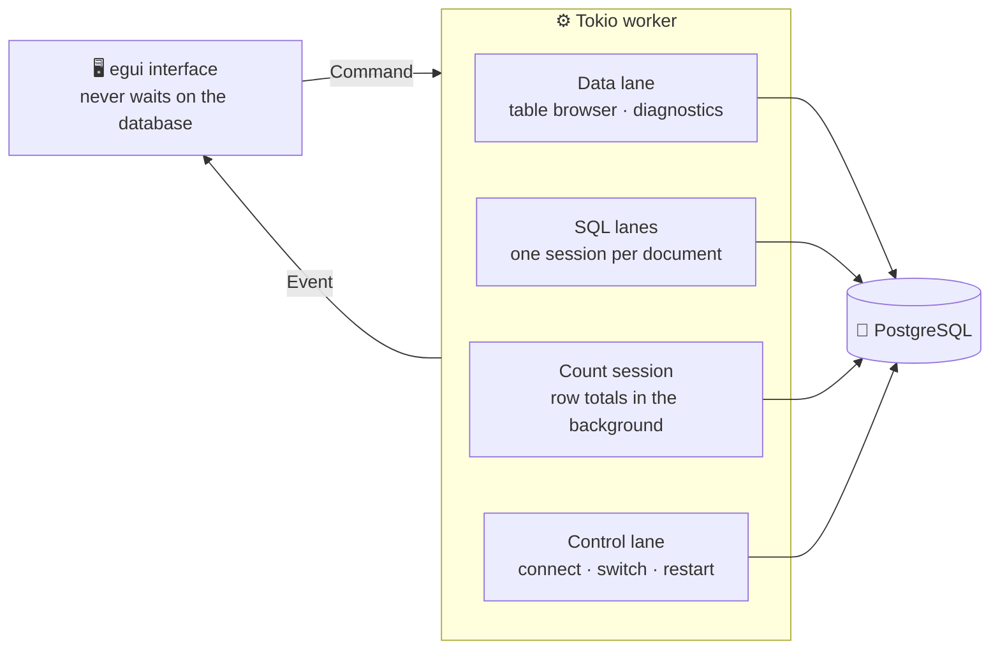

<div align="center">

<picture>
  <source media="(prefers-color-scheme: dark)" srcset="assets/banner-dark.png">
  <source media="(prefers-color-scheme: light)" srcset="assets/banner-light.png">
  
</picture>

<br/>
<br/>

[](#-quick-start)
[](rust-toolchain.toml)
[](#-testing)
[](https://github.com/emilk/egui)
[](#-architecture)
[](LICENSE)


**[Quick start](#-quick-start)** ·
**[Features](#-feature-tour)** ·
**[Screenshots](#%EF%B8%8F-gallery)** ·
**[Shortcuts](#%EF%B8%8F-keyboard-shortcuts)** ·
**[Architecture](#-architecture)** ·
**[Roadmap](ROADMAP.md)**

</div>

<br/>

## 💡 Why Postern

Postern is a focused PostgreSQL desktop client written entirely in Rust. It keeps
the workflow that makes Postico pleasant (saved servers, a compact object sidebar,
a data grid with staged edits, a structure editor, and a split SQL editor) and adds
a fast native core, careful data handling, and built-in diagnostics.

- **It stays out of your way.** Database work runs on background lanes, so a long
  query never freezes browsing or another SQL document.
- **It never guesses with your data.** NULL stays distinct from an empty string,
  values keep PostgreSQL's exact text, and every grid write is checked against
  the row you saw.
- **It helps you tune.** An index advisor and a slow query list sit one click away,
  and Postern can even set up `pg_stat_statements` for you.

> [!NOTE]
> Postern is an independent implementation inspired by Postico. It is not a copy of
> Postico and does not cover every Postico feature. See [ROADMAP.md](ROADMAP.md).

<br/>

<div align="center">
<picture>
  <source media="(prefers-color-scheme: dark)" srcset="assets/hero-dark.png">
  <source media="(prefers-color-scheme: light)" srcset="assets/hero-light.png">
  
</picture>
</div>

<br/>

## ✨ Highlights

<table>
  <tr>
    <td width="33%" valign="top">
      <h3>⚡ Fast browsing</h3>
      Sorts and limits on the server before converting a page to text, so an index
      serves the sort in both directions. Row totals are counted on a separate
      session while you keep browsing.
    </td>
    <td width="33%" valign="top">
      <h3>✏️ Staged edits</h3>
      Edit cells, add rows, paste from a spreadsheet, and mark rows for deletion.
      Everything is highlighted until one <b>Save</b> writes it in a single
      transaction with conflict checks.
    </td>
    <td width="33%" valign="top">
      <h3>🧠 A SQL editor that knows your schema</h3>
      Completion through table aliases, per-statement scripts like psql, error
      locations in the editor, find and replace, and a formatter that never
      changes literals.
    </td>
  </tr>
  <tr>
    <td valign="top">
      <h3>🔬 Plans you can read</h3>
      <code>EXPLAIN</code> and <code>EXPLAIN ANALYZE</code> as a tree with timings
      and misestimate warnings. Analyze runs inside a rolled-back transaction, and
      recorded statements with <code>$1</code> get generic plans.
    </td>
    <td valign="top">
      <h3>🩺 Diagnostics</h3>
      An index advisor for invalid, duplicate, redundant, unused, and missing
      foreign key indexes, plus the slowest statements from
      <code>pg_stat_statements</code>, with one-click setup.
    </td>
    <td valign="top">
      <h3>🔐 Safe by default</h3>
      Keychain or <code>~/.pgpass</code> passwords, SSH tunnels, TLS with
      certificate verification, read-only profiles, and no passwords in files,
      history, or logs.
    </td>
  </tr>
  <tr>
    <td valign="top">
      <h3>🧵 Never blocks</h3>
      The table browser, each SQL document, and connection management run on
      separate lanes of a Tokio worker. Transactions never leak between them.
    </td>
    <td valign="top">
      <h3>🎯 Exact values</h3>
      Exact numerics, arrays, UUIDs, JSON, and <code>bytea</code> (hex, Base64, or
      ULID). Characters missing from the UI fonts fall back to installed system
      fonts, from Chinese to Thai.
    </td>
    <td valign="top">
      <h3>🌗 At home on the Mac</h3>
      Light, dark, or system appearance, a native menu bar, familiar shortcuts,
      and remembered window and column sizes.
    </td>
  </tr>
</table>

<br/>

## 📚 Table of contents

- [Quick start](#-quick-start)
- [Feature tour](#-feature-tour)
  - [Connections](#-connections)
  - [Table browser](#%EF%B8%8F-table-browser)
  - [Structure and objects](#%EF%B8%8F-structure-and-objects)
  - [SQL editor](#-sql-editor)
  - [Diagnostics](#-diagnostics)
  - [Server and appearance](#%EF%B8%8F-server-and-appearance)
- [Gallery](#%EF%B8%8F-gallery)
- [Performance](#-performance)
- [Keyboard shortcuts](#%EF%B8%8F-keyboard-shortcuts)
- [Architecture](#-architecture)
- [Sessions, storage, and privacy](#-sessions-storage-and-privacy)
- [Testing](#-testing)
- [The name and the icon](#-the-name-and-the-icon)
- [Scope and acknowledgements](#-scope-and-acknowledgements)
- [License](#-license)

<br/>

## 🚀 Quick start

Postern runs on macOS 13 or later. It is tested on Apple Silicon; Intel Macs
should build from source but have not been tested.

### Download the app

The easiest way, with no developer tools:

1. Download `Postern-<version>-arm64.dmg` from the
   [latest release](../../releases/latest).
2. Open it and drag **Postern** onto **Applications**.
3. Open Postern from Applications. Releases are not notarized by Apple yet, so the
   first time macOS says it cannot verify the app. Open **System Settings ›
   Privacy & Security**, choose **Open Anyway** next to the message about
   Postern, and confirm. On macOS 13 and 14 you can instead Control-click the app,
   choose **Open**, and confirm.
4. To keep Postern in the Dock, right-click its icon and choose **Options › Keep in
   Dock**.

### Build it with one command

If you have the source, or want the latest changes, one script does the rest:

```sh
git clone <repository-url> postern
cd postern
./install.sh
```

`install.sh` checks the Xcode command line tools and opens their installer when
they are missing. It installs Rust with [rustup](https://rustup.rs/) when Rust is
missing, then the version the project pins. Finally it builds Postern, installs it
in `/Applications`, and opens it. The first build takes a few minutes. Use
`./install.sh --no-open` to skip opening the app.

<details>
<summary><b>Build it step by step</b></summary>
<br/>

##### 1. Install the developer tools

The Xcode command line tools provide Git and the linker that Rust uses on macOS:

```sh
xcode-select --install
```

Install Rust with [rustup](https://rustup.rs/), the official installer, and accept
the default options:

```sh
curl --proto '=https' --tlsv1.2 -sSf https://sh.rustup.rs | sh
```

Make `cargo` available in this terminal and in every new one, then check it:

```sh
echo '. "$HOME/.cargo/env"' >> ~/.zshrc
source ~/.zshrc
cargo --version
```

##### 2. Get the code

Clone the repository, using its address in place of `<repository-url>`, and install
the Rust version the project pins:

```sh
git clone <repository-url> postern
cd postern
rustup toolchain install
```

`rustup toolchain install` reads `rust-toolchain.toml` and installs Rust 1.99.1
with rustfmt and clippy. Every `cargo` command in this folder uses that version.

##### 3. Run Postern from source

```sh
cargo run --release --locked
```

The first build downloads and compiles the dependencies, which takes a few
minutes; later runs start in seconds. `--locked` builds exactly the versions in
`Cargo.lock`. The window opens on the server list.

##### 4. Install it as a Mac app

```sh
sh scripts/bundle-macos.sh --install
```

This builds `Postern.app`, signs it locally, copies it to `/Applications`, and
registers it, so Postern appears in Spotlight and the Applications folder. Open
it, then right-click its icon in the Dock and choose **Options › Keep in Dock**.

Without `--install`, the script leaves the application in `dist/Postern.app`, and
Spotlight then lists it next to an installed copy. The app is built for the
current machine's architecture with a local ad-hoc signature.

</details>

### Connect to PostgreSQL

Postern needs a running PostgreSQL server. Any of these works:

| Server | Start it | Connection in Postern |
| --- | --- | --- |
| [Postgres.app](https://postgresapp.com) | Open the app, then **Initialize** the first time or **Start** | Host `localhost`, port `5432`, your macOS user name, no password |
| [Homebrew](https://brew.sh) | `brew install postgresql@17`, then `brew services start postgresql@17` | Host `localhost`, port `5432`, your macOS user name, no password |
| [Docker](https://www.docker.com) | `docker run -d --name postgres -e POSTGRES_PASSWORD=secret -p 5432:5432 postgres:17` | Host `localhost`, port `5432`, user `postgres`, password `secret` |
| A remote server | Ask its administrator for a connection URL | **New Server from URL...** and paste the `postgresql://` URL |

Then, in Postern:

1. Choose **+ New Server**. The form starts with host `localhost`, port `5432`,
   database `postgres`, and your macOS user name.
2. Change what differs for your server. Enter a password if it needs one, and tick
   **Save password in macOS Keychain** to remember it.
3. Choose **Test**, then **Connect**. **Show Databases** lists the server's
   databases if you are not sure which one to open.

Postgres.app asks once whether Postern may connect; allow it.

### Updating

Download the new disk image and drag Postern onto Applications again, replacing
the old copy. From source, quit Postern and run:

```sh
git pull
./install.sh
```

### Sharing and releasing

`sh scripts/make-dmg.sh` builds `dist/Postern-<version>-<architecture>.dmg`, a disk
image that installs by dragging the app onto Applications. Pushing a version tag,
such as `v0.1.0`, to GitHub runs the release workflow, which builds the image and
publishes it as a GitHub release for the download link above.

### Uninstalling

Delete `/Applications/Postern.app`. Saved servers, queries, and settings are in
`~/Library/Application Support/dev.postern.Postern`, and saved passwords are in
Keychain Access under `dev.postern.database`; remove them too for a clean slate.

<details>
<summary><b>Troubleshooting</b></summary>
<br/>

| Problem | Fix |
| --- | --- |
| `zsh: command not found: cargo` | Run `source "$HOME/.cargo/env"`, and add it to `~/.zshrc` as in step 1. |
| `xcrun: error: invalid active developer path` | Install the command line tools with `xcode-select --install`. |
| `toolchain '1.99.1-…' is not installed` | Run `rustup toolchain install` in the project folder. |
| Spotlight or the Apps view lists Postern twice | Delete `dist/Postern.app`, or build with `--install`, which removes it. |
| `Connection refused` | The server is not running or uses another port. Start it, and check the port in the connection form. |
| `password authentication failed` | Check the user name and password. An empty password field falls back to `~/.pgpass`. |
| macOS says it cannot verify Postern | The release is not notarized. Allow it once in **System Settings › Privacy & Security** with **Open Anyway**. |
| macOS asks to use a Keychain item | Choose **Always Allow**. It asks again after each rebuild, because every build gets a new local signature. |

</details>

<br/>

## 🧭 Feature tour

### 🔌 Connections

- Save, edit, duplicate, group into folders, remove, import, and export connection
  profiles. Exported files never contain passwords.
- Store a password in the macOS Keychain, or leave it empty to use `~/.pgpass`
  (or `PGPASSFILE`). Like libpq, the file is ignored when group or other users can
  read it.
- Create a server from a `postgresql://` URL or a libpq `key=value` string,
  including `sslmode=verify-ca`/`verify-full`, `sslrootcert`, `sslcert`, `sslkey`,
  and `options`.
- Connect over TCP or a Unix socket, directly or through an SSH tunnel run by the
  system OpenSSH client.
- Per profile: read-only sessions, startup SQL, extra libpq `options`, and the SQL
  editor's statement timeout.
- **Show Databases** lists the server's databases before connecting. After
  connecting, the toolbar switches databases and can create or drop one.

<details>
<summary><b>TLS and SSH details</b></summary>
<br/>

- SSL modes are Disable, Prefer, Require, Verify CA, and Verify Full. Prefer and
  Require follow libpq: they do not authenticate the server certificate, and
  Prefer can use plaintext. Add CA certificates and a client certificate with an
  unencrypted PKCS#8 key.
- SSH host keys are checked against `~/.ssh/known_hosts`; authentication uses the
  SSH agent or an identity file. Password and keyboard-interactive SSH logins are
  not supported.

</details>

### 🗂️ Table browser

- Tables, views, materialized views, foreign tables, and partitioned tables are
  grouped by schema; partitions are nested under their parent.
- Browse 25 to 500 rows per page and sort by one or more columns (Option-click).
  The footer shows the visible range and the total, such as `Rows 1–100 of 56 000`.
- Filter with any number of conditions, matched all or any: contains, begins and
  ends with, equals, comparisons, regular expressions, NULL checks, and lists, plus
  an optional SQL expression. Right-click a value to filter by it.
- Edit cells inline (double-click or Return), in a full editor, or in the row
  details panel. Add rows, mark rows for deletion, and paste rows copied from a
  spreadsheet or another grid.
- Changes are staged and highlighted until **Save** (Command-S) writes them in one
  transaction, or **Discard** drops them. Pages, sorting, filters, and other
  tables are locked while changes are pending, and quitting asks first.
- Follow foreign keys to the referenced row, list rows that reference the current
  row, and go back. Choose a foreign key value by searching the referenced table.
- Copy selected rows as tab-separated text, CSV, JSON, Markdown, or INSERT
  statements, or copy a column's values.
- Hide columns per table and show `bytea` values as hex, Base64, or ULID.
- Import CSV with COPY in one transaction, mapping file fields to columns. Export
  the current page, or stream every matching row to CSV.

<details>
<summary><b>Under the hood: sorting, counting, and safe writes</b></summary>
<br/>

- Sorting sends one round trip, sorts and limits before converting the page's
  values to text, and leaves NULL placement to PostgreSQL by default (last when
  ascending, first when descending), so an index on the column serves the sort in
  both directions. NULLs first or last can be chosen explicitly. Types without an
  ordering, such as json, sort by their text. The current page stays visible while
  the next one loads.
- Tables estimated below two million rows are counted automatically on a separate
  session, so counting never delays browsing; larger tables show PostgreSQL's
  estimate (`≈`) and a **Count** button.
- Updates and deletes require a primary key. Each row is located by its primary
  key, which uses the key's index, and checked against every original value, so a
  concurrent change rolls back the whole save. Values are cast to the column type
  without modifiers, so an over-long `varchar(n)` value is rejected instead of
  truncated.
- Tab-separated copies use PostgreSQL's COPY text format, so pasting them back
  keeps NULLs and special characters. Column widths, hidden columns, and the
  window size are remembered.

</details>

### 🏗️ Structure and objects

- View columns, constraints, indexes with size and usage, referencing foreign keys,
  privileges, and table statistics.
- Edit a table's structure, or create a table, in a form: rename and retype
  columns, change nullability, defaults, and comments, and add or drop columns,
  constraints, and indexes. The generated SQL is shown for review and runs in one
  transaction.
- The DDL tab generates SQL that recreates the table, including identity and
  generated columns, collations, partitioning, inheritance, storage options,
  constraints, indexes, triggers, row-level security policies, owned sequences, and
  comments. Ownership and privileges are not included.
- Rename, truncate, drop, vacuum, analyze, reindex, and refresh materialized views
  from the sidebar, and create schemas.
- Browse functions and procedures, view their definitions, open them in the SQL
  editor to change them, and drop them.

### 📝 SQL editor

- Keep multiple SQL documents in folders, reorder them, open and save `.sql`
  files, and remove documents (− button, right-click, or Command-W). Removing a
  document never deletes its file.
- A document whose file changes on disk is reloaded when it has no unsaved edits;
  otherwise a banner offers to reload or keep the editor version.
- Run the selection or the statement at the cursor (Command-Return), or the whole
  document (Command-Shift-Return). Scripts run one statement at a time, like psql,
  so VACUUM and other non-transactional commands work. Execution stops at the first
  error, which is located in the editor with its line and column.
- Each document has its own session, so transactions are independent and documents
  run at the same time. An indicator shows an open or failed transaction.
- Line numbers, syntax highlighting, find and replace (Command-F), and schema-aware
  completion of columns (including through table aliases), tables, schemas,
  functions, and keywords.
- Format the selection or the document (Control-F). Formatting is applied only when
  string literals, dollar-quoted bodies, identifiers, operators, and comments are
  unchanged.
- Separate result tabs per statement, NOTICE and WARNING messages, execution time,
  query history, and cancellation.
- **Explain** or **Explain Analyze** (Command-E) shows the plan as a tree with
  timings and estimate warnings. Explain Analyze runs the statement inside a
  transaction or savepoint that is rolled back. A statement with `$1` parameters,
  as recorded by `pg_stat_statements`, gets a generic plan on PostgreSQL 16 and
  later.
- Export a result as CSV, or re-run a read-only query and stream all of its rows.

### 🩺 Diagnostics

**Diagnostics** in the toolbar or the View menu has two tabs. Advisor fixes and
recorded statements open in a new SQL document, with the finding as a comment, for
you to review and run. Only the `pg_stat_statements` setup buttons change the
server, and the restart asks for confirmation first.

<table>
  <tr>
    <td width="50%" valign="top">
      <b>Index advisor</b><br/><br/>
      Finds invalid indexes left by a failed <code>CREATE INDEX CONCURRENTLY</code>,
      foreign keys whose columns do not lead any index, duplicate indexes, indexes
      that are the leading columns of a longer B-tree index, unused indexes, large
      tables read mostly by sequential scans, and tables with many dead rows. It
      shows the space the listed indexes use and offers
      <code>CREATE INDEX CONCURRENTLY</code>, <code>DROP INDEX CONCURRENTLY</code>,
      <code>REINDEX</code>, or <code>VACUUM (ANALYZE)</code>.
    </td>
    <td width="50%" valign="top">
      <b>Slow queries</b><br/><br/>
      Lists up to 200 statements from
      <a href="https://www.postgresql.org/docs/current/pgstatstatements.html"><code>pg_stat_statements</code></a>
      by total time, mean time, calls, or rows, with each statement's share of the
      total, maximum time, and cache hit ratio, for the current database or all of
      them. Catalog queries from database clients are hidden unless you ask. Open,
      explain, or copy any statement, or reset the statistics.
    </td>
  </tr>
</table>

<details>
<summary><b>What the advisor never proposes</b></summary>
<br/>

Primary keys, unique indexes, constraint indexes, and partition indexes are never
proposed for dropping. An index that starts with a foreign key column is not
reported as unused, because deleting referenced rows needs it. Partial and
expression indexes are only checked for use. Usage counts come from this server's
statistics since their last reset, so check replicas before dropping an index.

</details>

<details>
<summary><b>One-click <code>pg_stat_statements</code> setup</b></summary>
<br/>

When `pg_stat_statements` is not set up, **Slow queries** lists the missing steps
and offers a button for the next one Postern can take.

1. **Set up and restart server** adds the library to `shared_preload_libraries`
   with `ALTER SYSTEM`, keeping the libraries already configured. It then restarts
   the server with a fast shutdown, reconnects, and creates the extension. A
   confirmation names the data directory and the number of other applications'
   sessions it disconnects.
2. The restart is offered only for a server that runs on this Mac under your
   account and was started with `pg_ctl`, such as Postgres.app. It keeps the
   server's command line. When that command line sets `shared_preload_libraries`,
   as Postgres.app does, the library is added there too. If the server does not
   start, Postern starts it again with its previous settings and undoes the
   configuration change.
3. For other servers, **Add to shared_preload_libraries** changes the
   configuration, and you restart the server with the tool that manages it. When
   the library is already loaded, **Install** creates the extension.

These steps need a superuser and are disabled for read-only connections. An open
transaction in a SQL document blocks the restart.

</details>

### 🖥️ Server and appearance

- **Activity** lists client sessions with their state, wait events, and running
  query, with optional automatic refresh. Cancel a query or terminate a session.
- **Roles** lists roles, their attributes, and memberships.
- Light, dark, or system appearance, and a native macOS menu bar.
- Characters missing from the primary UI and SQL fonts use installed system fonts,
  including Chinese, Japanese, Korean, Arabic, Hindi, and Thai. Full bidirectional
  text editing is still limited by egui.
- Values keep PostgreSQL's textual representations, including exact numerics,
  arrays, UUIDs, JSON, and `bytea`. NULL stays distinct from an empty string.

<br/>

## 🖼️ Gallery

<table>
  <tr>
    <td width="50%"><br/><b>Staged edits</b> with the row details panel</td>
    <td width="50%"><br/><b>Filters</b> with any number of conditions</td>
  </tr>
  <tr>
    <td><br/><b>SQL editor</b> with a result tab per statement</td>
    <td><br/><b>Completion</b> through a table alias</td>
  </tr>
  <tr>
    <td><br/><b>EXPLAIN ANALYZE</b> as a timed tree</td>
    <td><br/><b>Structure editor</b> with reviewed SQL</td>
  </tr>
  <tr>
    <td><br/><b>Index advisor</b> with ready-made fixes</td>
    <td><br/><b>Slow queries</b> from <code>pg_stat_statements</code></td>
  </tr>
  <tr>
    <td><br/><b>One-click setup</b> of <code>pg_stat_statements</code></td>
    <td><br/><b>Activity</b> with cancel and terminate</td>
  </tr>
</table>

More views, including Unicode text, generated DDL, foreign key navigation, and the
light appearance, are in [docs/verification.md](docs/verification.md).

<br/>

## 📈 Performance

Measured on a 56,000-row table on a local server, median end to end through the
table browser's own code path:

| Operation | Time |
| --- | ---: |
| Sort by an indexed column, descending | **0.3 ms** |
| Sort by an unindexed text column | 17.7 ms, the same as a plain `SELECT … ORDER BY … LIMIT` |
| Count the whole table, in the background | 2.5 to 5 ms |

Deep pages still pay for PostgreSQL's `OFFSET`, which reads past every earlier row.

<br/>

## ⌨️ Keyboard shortcuts

| Shortcut | Action |
| --- | --- |
| <kbd>⌘</kbd> <kbd>↩</kbd> | Run the selection, or the statement at the cursor |
| <kbd>⌘</kbd> <kbd>⇧</kbd> <kbd>↩</kbd> | Run the whole document |
| <kbd>⌘</kbd> <kbd>E</kbd> | Explain the selection or the statement at the cursor |
| <kbd>⌘</kbd> <kbd>.</kbd> | Cancel the running operation |
| <kbd>⌘</kbd> <kbd>T</kbd> | New SQL document |
| <kbd>⌘</kbd> <kbd>O</kbd> | Open a SQL file |
| <kbd>⌘</kbd> <kbd>S</kbd> | Save the SQL file, or save staged table changes |
| <kbd>⌘</kbd> <kbd>⇧</kbd> <kbd>S</kbd> | Save the SQL document to a new file |
| <kbd>⌘</kbd> <kbd>W</kbd> | Remove the current SQL document, with confirmation if it contains SQL |
| <kbd>⌘</kbd> <kbd>F</kbd> · <kbd>⌘</kbd> <kbd>G</kbd> · <kbd>⌘</kbd> <kbd>⇧</kbd> <kbd>G</kbd> | Find, next match, previous match |
| <kbd>⌃</kbd> <kbd>F</kbd> | Format SQL |
| <kbd>⌃</kbd> <kbd>Space</kbd> | Show completions |
| <kbd>⌘</kbd> <kbd>R</kbd> | Refresh the table, keeping filter, sort, and page, or rerun the diagnostics |
| <kbd>⌘</kbd> <kbd>[</kbd> | Back to the previous table after following a foreign key |
| <kbd>⌥</kbd> click a header | Add a sort column |
| <kbd>←</kbd> <kbd>→</kbd> <kbd>↑</kbd> <kbd>↓</kbd> · <kbd>↩</kbd> · <kbd>⇥</kbd> · <kbd>Esc</kbd> | Move between cells, edit, edit the next cell, cancel |
| <kbd>⇧</kbd> click · <kbd>⇧</kbd> arrow | Extend the row selection |
| <kbd>⌘</kbd> <kbd>C</kbd> · <kbd>⌘</kbd> <kbd>V</kbd> · <kbd>⌘</kbd> <kbd>A</kbd> | Copy rows, paste rows as new rows, select all rows |
| <kbd>⌫</kbd> | Mark the selected rows for deletion |

Grid keys apply when the grid has focus; in text fields they keep their normal
behavior. Selection belongs to the current page.

<br/>

## 🏛 Architecture



| Path | Responsibility |
| --- | --- |
| `src/models.rs` | Profiles, metadata, filters, staged changes, diagnostics, documents |
| `src/sql.rs`, `src/sql/` | Quoting, browse and mutation SQL, DDL, formats, the PostgreSQL-aware lexer, completion |
| `src/services/` | Connections and TLS, catalog queries, the worker and its lanes, SSH, `.pgpass`, storage, local server restarts |
| `src/ui/` | The egui application: servers, navigator, grid, structure editor, SQL editor, plans, diagnostics, menus, theme |

Database work never runs on the UI thread, SQL is built in one place with every
identifier quoted, and the table browser never shares a transaction with the SQL
editor. The full design is in [docs/architecture.md](docs/architecture.md).

<br/>

## 🔒 Sessions, storage, and privacy

- The table browser's session has a 30-second statement timeout, a 5-second lock
  timeout, and a 60-second idle-in-transaction timeout. SQL sessions use the
  profile's statement timeout (30 seconds by default, 0 for none) and no
  idle-in-transaction timeout.
- Grid saves never commit a transaction opened in the SQL editor. Explicit SQL
  transactions must be committed or rolled back by you; disconnecting or removing a
  document rolls them back.
- A session closed by the server or the network is reconnected on the next
  operation, and the editor reports that any open transaction was rolled back.
- SQL results retain at most 5,000 rows across all result sets, 16 MiB of cell
  payload, and 64 statement results; statements still execute in full.
- Switching databases prepares new sessions before replacing the current ones, so a
  failed connection leaves the workspace connected. An open or aborted transaction
  in any SQL document blocks switching until you COMMIT or ROLLBACK. The database
  list comes from the
  [`pg_database` catalog](https://www.postgresql.org/docs/current/catalog-pg-database.html)
  and contains the databases the login may connect to.
- Profiles, SQL drafts, display settings, and the last 100 user queries are stored
  in `~/Library/Application Support/dev.postern.Postern` with private permissions.
  Files use atomic replacement; corrupt files are reported and preserved. Saved SQL
  files and exports keep the permissions of an existing file and follow symbolic
  links. `POSTERN_DATA_DIR` selects a separate directory for tests.
- Statements that contain the word PASSWORD are never added to the history, but SQL
  drafts may still contain sensitive text.

> [!NOTE]
> Postern was called PG Manager before. On the first start, data saved under that
> name (`~/Library/Application Support/dev.pgmanager.PG-Manager`) is moved to the new
> directory, unless the new directory already exists. Keychain passwords move from
> the `dev.pgmanager.database` service to `dev.postern.database` when a connection
> first reads them.

<br/>

## 🧪 Testing

```sh
cargo fmt --check
cargo clippy --locked --all-targets --all-features -- -D warnings
cargo test --locked
sh scripts/test-postgres.sh
```

> [!IMPORTANT]
> The database tests never connect to an existing database. `scripts/test-postgres.sh`
> creates an isolated cluster on port 55439, with `pg_stat_statements` preloaded,
> and a second one on the next port, started the way Postgres.app starts its
> servers, which the setup test restarts. Both stop on exit.

The default tool path is Postgres.app; set `PG_BIN` for another installation and
`POSTERN_TEST_PORT` if the port is taken. Temporary cluster files are kept for
inspection. Plain `cargo test` skips the database tests.

Capture the application's real views against synthetic data:

```sh
POSTERN_CAPTURE_DIR=/tmp/postern-captures sh scripts/test-postgres.sh
```

This builds the optional `smoke` feature and needs a macOS GUI session with the
display awake (`caffeinate -d` helps). It drives the connection worker and the
table, SQL, structure, server, and diagnostics views, captures only the
application's own framebuffer, and closes each window. `scripts/demo.sql` seeds the
synthetic data. Set `POSTERN_SMOKE_SCREENS` to a space-separated list to capture
fewer views and `POSTERN_SMOKE_DEBUG=1` to trace the harness. It is not full mouse
and keyboard coverage. Results and every screenshot are in
[docs/verification.md](docs/verification.md).

<br/>

## 🦣 The name and the icon

A **postern** is a small side gate in a castle wall: a quick, quiet way in. Postern
is that for your databases.


The icon is a woolly mammoth whose head is a database cylinder, a nod to Slonik,
PostgreSQL's elephant. It is drawn in code by `scripts/icon.swift`, and
`sh scripts/make-artwork.sh` regenerates the icon, these banners, and the framed
screenshots in `assets/`.

<br clear="right"/>

<br/>

## 🧩 Scope and acknowledgements

What is not implemented yet is listed in [ROADMAP.md](ROADMAP.md). PostgreSQL
compatibility layers such as CockroachDB and Redshift have not been validated.

The closest local reference was [SequelPG](https://github.com/mihailShumilov/SequelPG),
particularly its ConnectionProfile, QueryResult, connection storage, background
database access, and navigator, content, and query separation. Its Swift
implementation was used as an architectural reference, not copied into this Rust
project. UI references: the supplied Postico screenshots and the
[Postico changelog](https://releases.eggerapps.at/postico2/changelog).

<br/>

## 📄 License

Postern is released under the [MIT License](LICENSE). Copyright © 2026 Lucky-Dutch.

<div align="center">
<br/>
<sub>Built with 🦀 Rust, <a href="https://github.com/emilk/egui">egui</a>, <a href="https://tokio.rs">Tokio</a>, and <a href="https://github.com/sfackler/rust-postgres">tokio-postgres</a>.</sub>
</div>
