<div align="center">

<picture>
  <source media="(prefers-color-scheme: dark)" srcset="assets/banner-dark.png">
  <source media="(prefers-color-scheme: light)" srcset="assets/banner-light.png">
  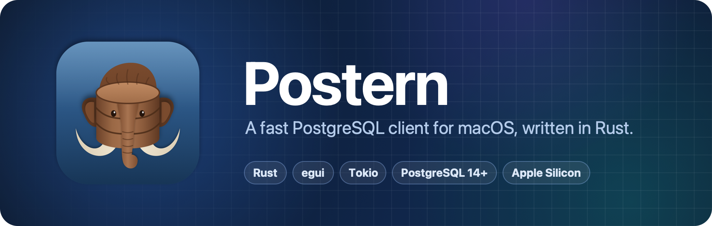
</picture>

<br/>
<br/>

[](#-quick-start)
[](rust-toolchain.toml)
[](#-limitations)
[](https://github.com/emilk/egui)
[](#-architecture)
[](LICENSE)

**[Quick start](#-quick-start)** ·
**[Features](#-features)** ·
**[Screenshots](#%EF%B8%8F-screenshots)** ·
**[Shortcuts](#%EF%B8%8F-keyboard-shortcuts)** ·
**[Roadmap](ROADMAP.md)**

</div>

<br/>

Postern is a PostgreSQL client for macOS, written in Rust. Use it to browse and
edit tables, change table structure, run SQL, and find slow queries and missing
indexes. It works like Postico: a list of saved servers, a sidebar with your
tables, a data grid, and a SQL editor.

<br/>

<div align="center">
<picture>
  <source media="(prefers-color-scheme: dark)" srcset="assets/hero-dark.png">
  <source media="(prefers-color-scheme: light)" srcset="assets/hero-light.png">
  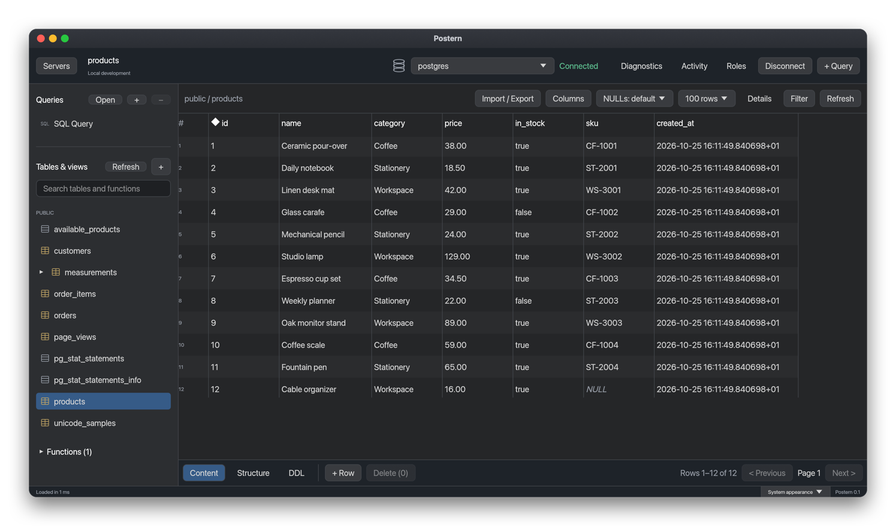
</picture>
</div>

<br/>

## ✨ Highlights

<table>
  <tr>
    <td width="33%" valign="top">
      <h3>⚡ Fast</h3>
      A long query never freezes the app. Sorting uses the table's indexes, and
      row counts load in the background.
    </td>
    <td width="33%" valign="top">
      <h3>✏️ Safe edits</h3>
      Edit cells, add rows, and delete rows. Nothing is written until you press
      <b>Save</b>. Then all changes are saved in one transaction, and Postern
      checks that nobody changed those rows in the meantime.
    </td>
    <td width="33%" valign="top">
      <h3>🧠 SQL editor</h3>
      Completes table and column names, also through aliases. Shows the line of
      an error. Formats SQL without touching your values.
    </td>
  </tr>
  <tr>
    <td valign="top">
      <h3>🔬 Query plans</h3>
      Shows <code>EXPLAIN</code> and <code>EXPLAIN ANALYZE</code> as a tree with
      times. <code>EXPLAIN ANALYZE</code> is rolled back, so it never changes
      data.
    </td>
    <td valign="top">
      <h3>🩺 Diagnostics</h3>
      Finds missing, duplicate, and unused indexes. Lists the slowest queries
      from <code>pg_stat_statements</code>, and can set it up for you.
    </td>
    <td valign="top">
      <h3>🔐 Secure</h3>
      Passwords stay in the macOS Keychain or <code>~/.pgpass</code>, never in
      files or logs. SSH tunnels, TLS, and read-only connections.
    </td>
  </tr>
  <tr>
    <td valign="top">
      <h3>🎯 Exact values</h3>
      NULL is not an empty string. Numbers, JSON, arrays, and
      <code>bytea</code> are shown exactly as PostgreSQL returns them.
    </td>
    <td valign="top">
      <h3>🌍 Any script</h3>
      Chinese, Japanese, Korean, Arabic, Hindi, Thai, and other scripts display
      correctly.
    </td>
    <td valign="top">
      <h3>🌗 Native Mac app</h3>
      Light and dark mode, a macOS menu bar, and the usual shortcuts. No web
      view.
    </td>
  </tr>
</table>

<br/>

## 🚀 Quick start

Postern needs macOS 13 or later. It is tested on Apple Silicon.

### Download

1. Download `Postern-<version>-arm64.dmg` from the
   [latest release](../../releases/latest).
2. Open it and drag **Postern** to **Applications**.
3. Open Postern. The app is not notarized yet, so the first time macOS says it
   cannot check it. Go to **System Settings › Privacy & Security** and choose
   **Open Anyway**.

### Build from source

```sh
git clone https://github.com/Lucky-Dutch/postern.git
cd postern
./install.sh
```

The script installs the Xcode command line tools and Rust if they are missing,
builds Postern, and copies it to `/Applications`. The first build takes a few
minutes.

<details>
<summary><b>Build it step by step</b></summary>
<br/>

```sh
xcode-select --install                                         # Git and the linker
curl --proto '=https' --tlsv1.2 -sSf https://sh.rustup.rs | sh  # Rust
source "$HOME/.cargo/env"

git clone https://github.com/Lucky-Dutch/postern.git
cd postern
rustup toolchain install                # the Rust version from rust-toolchain.toml

cargo run --release --locked            # run from source
sh scripts/bundle-macos.sh --install    # or install /Applications/Postern.app
```

</details>

### Connect to a server

You need a running PostgreSQL server. For example:

| Server | Start it | Enter in Postern |
| --- | --- | --- |
| [Postgres.app](https://postgresapp.com) | Open the app and choose **Initialize** (first time) or **Start** | `localhost`, port `5432`, your macOS user name, no password |
| [Homebrew](https://brew.sh) | `brew install postgresql@17`, then `brew services start postgresql@17` | `localhost`, port `5432`, your macOS user name, no password |
| [Docker](https://www.docker.com) | `docker run -d --name postgres -e POSTGRES_PASSWORD=secret -p 5432:5432 postgres:17` | `localhost`, port `5432`, user `postgres`, password `secret` |
| A remote server | Get a connection URL from its administrator | **New Server from URL...** and paste the `postgresql://` URL |

Then:

1. Choose **+ New Server**. The form is filled with local defaults.
2. Change what is different for your server. If it needs a password, enter it
   and tick **Save password in macOS Keychain**.
3. Choose **Test**, then **Connect**.

### Update and uninstall

- **Update:** download the new disk image and replace the app. From source, run
  `git pull` and `./install.sh`.
- **Uninstall:** delete `/Applications/Postern.app`. Settings are in
  `~/Library/Application Support/dev.postern.Postern`. Passwords are in Keychain
  Access under `dev.postern.database`.

<details>
<summary><b>Troubleshooting</b></summary>
<br/>

| Problem | Fix |
| --- | --- |
| macOS says it cannot verify Postern | Choose **Open Anyway** in **System Settings › Privacy & Security**. |
| `zsh: command not found: cargo` | Run `source "$HOME/.cargo/env"` and add that line to `~/.zshrc`. |
| `xcrun: error: invalid active developer path` | Run `xcode-select --install`. |
| `toolchain '1.99.1-…' is not installed` | Run `rustup toolchain install` in the project folder. |
| `Connection refused` | The server is not running, or it uses another port. |
| `password authentication failed` | Check the user name and password. An empty password field uses `~/.pgpass`. |
| macOS asks to use a Keychain item | Choose **Always Allow**. A build from source asks again after each rebuild. |
| Postern appears twice in Spotlight | Delete `dist/Postern.app`. |

</details>

<br/>

## 🧭 Features

### 🔌 Connections

- Save servers, group them in folders, and import or export them. Exported files
  never contain passwords.
- Create a server from a `postgresql://` URL or a `key=value` connection string.
- Connect over TCP, a Unix socket, or an SSH tunnel (SSH agent or key file).
- Use TLS with CA and client certificates. Only **Verify CA** and **Verify Full**
  check the server's certificate.
- Per server: read-only mode, SQL to run after connecting, and a timeout for SQL
  editor queries.
- Switch, create, and drop databases from the toolbar.

### 🗂️ Table browser

- Tables, views, materialized views, foreign tables, and partitions, grouped by
  schema.
- Open several tables in tabs. Clicking a table opens it or selects its existing
  tab. Each tab keeps its rows, filters, sort order, page, selection, structure
  draft, and pending edits while you switch, including during a load or save.
- Close a table with its × button or ⌘W. Closing a tab with pending changes asks
  before discarding them. Changing connections or databases requires saving or
  discarding changes in every tab. Table tabs last until you disconnect or quit.
- 25 to 500 rows per page. Sort by one or more columns (Option-click a header).
- Filter with several conditions or your own SQL expression. Right-click a value
  to filter by it.
- Edit a cell in place, in a larger editor, or in the row details panel. Add
  rows, delete rows, and paste rows from a spreadsheet.
- Changes stay highlighted until you choose **Save** (⌘S) or **Discard**.
  Updating and deleting rows needs a primary key.
- Follow a foreign key to the row it points to, and see which rows point to the
  current row. Pick a foreign key value by searching the other table.
- Hide columns, and show `bytea` as hex, Base64, or ULID.
- Copy rows as TSV, CSV, JSON, Markdown, or INSERT statements.
- Import a CSV file. Export the current page or all matching rows to CSV.
- Tables with fewer than about two million rows are counted automatically.
  Larger tables show an estimate and a **Count** button.

### 🏗️ Structure

- See columns, constraints, indexes with their size and usage, foreign keys,
  privileges, and statistics.
- Create or change a table in a form. Postern shows the SQL first and runs it in
  one transaction.
- See the SQL that recreates a table, with its indexes, triggers, and policies.
- Rename, truncate, drop, vacuum, analyze, and reindex from the sidebar. Refresh
  materialized views and create schemas.
- View, edit, and drop functions and procedures.

### 📝 SQL editor

- Keep many SQL documents in folders. Open and save `.sql` files.
- ⌘↩ runs the selection or the statement at the cursor. ⌘⇧↩ runs the whole
  document.
- Each document has its own connection. A transaction in one document never
  affects another document or the table browser.
- Statements run one by one, like in psql. On an error, Postern stops and shows
  the line and column.
- Completion for tables, columns (also through aliases), schemas, functions, and
  keywords.
- Find and replace, formatting, query history, and cancel (⌘.).
- One result tab per statement, with messages and run time. The editor keeps up
  to 5,000 rows. To get all rows of a read-only query, export it to CSV.
- **Explain** and **Explain Analyze** (⌘E) show the plan as a tree.

### 🩺 Diagnostics

Open **Diagnostics** in the toolbar.

- **Index advisor** finds broken indexes, foreign keys without an index,
  duplicate, redundant, and unused indexes, large tables read mostly by sequential scans, and
  tables with many dead rows. It never suggests dropping a primary key or unique
  index.
- **Slow queries** lists statements from `pg_stat_statements` by total time, mean
  time, calls, or rows.
- Postern never runs a fix by itself. It opens the SQL in a new document, so you
  can read it first.
- If `pg_stat_statements` is not set up, Postern can set it up. For a server on
  your Mac, such as Postgres.app, it can also restart the server. This needs a
  superuser.

### 🖥️ Server

- **Activity** shows sessions and running queries. Cancel a query or end a
  session.
- **Roles** shows roles and their memberships.

<br/>

## 🖼️ Screenshots

<table>
  <tr>
    <td width="50%">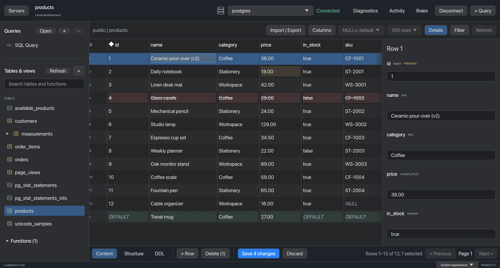<br/><b>Staged edits</b> with the row details panel</td>
    <td width="50%">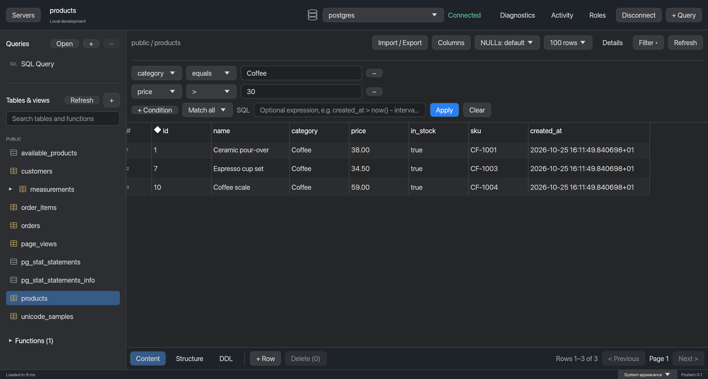<br/><b>Filters</b> with several conditions</td>
  </tr>
  <tr>
    <td>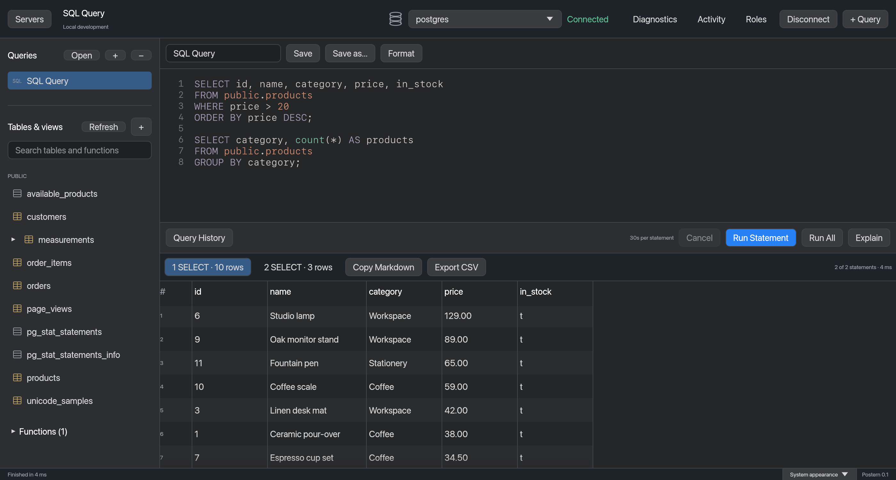<br/><b>SQL editor</b> with a result tab per statement</td>
    <td>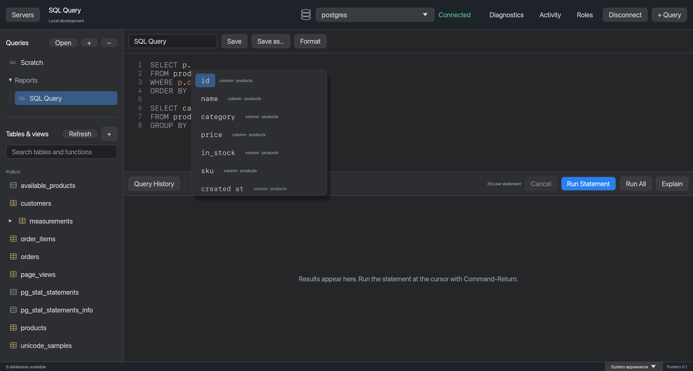<br/><b>Completion</b> through a table alias</td>
  </tr>
  <tr>
    <td>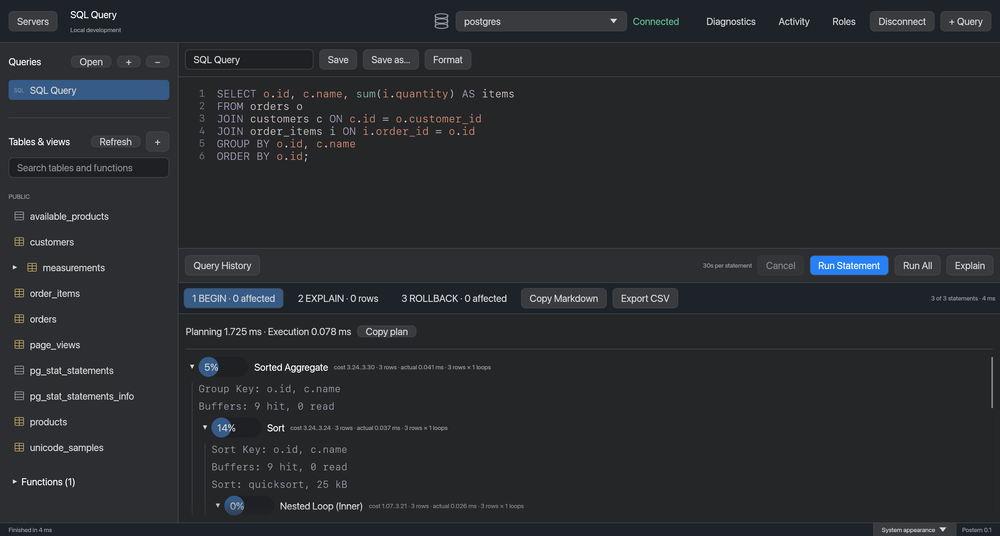<br/><b>EXPLAIN ANALYZE</b> as a tree with times</td>
    <td>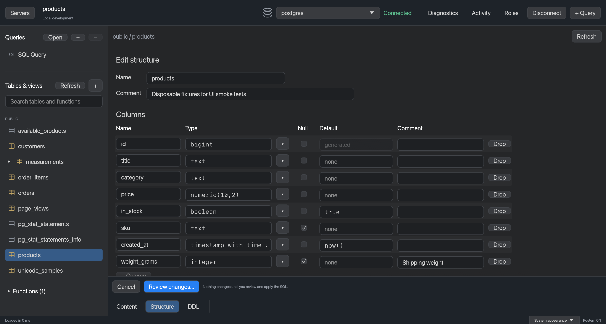<br/><b>Structure editor</b> with the SQL to review</td>
  </tr>
  <tr>
    <td>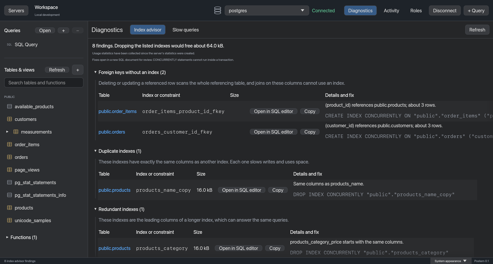<br/><b>Index advisor</b> with ready fixes</td>
    <td>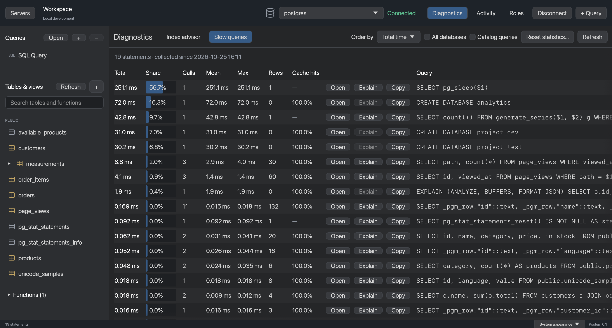<br/><b>Slow queries</b> from <code>pg_stat_statements</code></td>
  </tr>
  <tr>
    <td>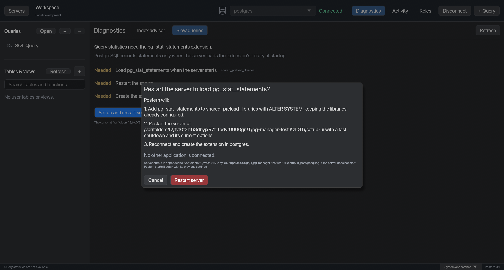<br/><b>Setup</b> of <code>pg_stat_statements</code></td>
    <td>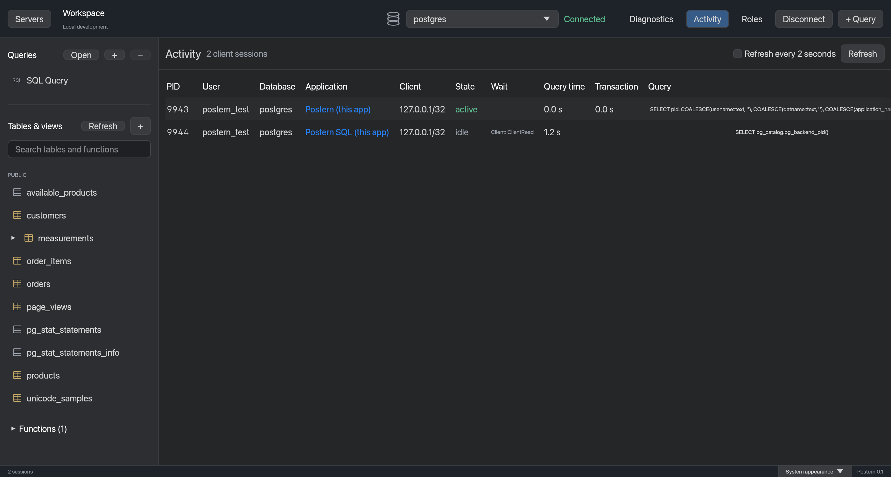<br/><b>Activity</b> with cancel and terminate</td>
  </tr>
</table>

More screenshots are in [docs/verification.md](docs/verification.md).

<br/>

## 📈 Performance

On a table with 56,000 rows on a local server:

| Operation | Time |
| --- | ---: |
| Sort by an indexed column | **0.3 ms** |
| Sort by a text column without an index | 17.7 ms, the same as plain SQL |
| Count all rows, in the background | 2.5 to 5 ms |

Pages far from the start are slower, because PostgreSQL's `OFFSET` reads all
earlier rows.

<br/>

## ⌨️ Keyboard shortcuts

| Shortcut | Action |
| --- | --- |
| <kbd>⌘</kbd> <kbd>↩</kbd> | Run the selection, or the statement at the cursor |
| <kbd>⌘</kbd> <kbd>⇧</kbd> <kbd>↩</kbd> | Run the whole document |
| <kbd>⌘</kbd> <kbd>E</kbd> | Explain the selection, or the statement at the cursor |
| <kbd>⌘</kbd> <kbd>.</kbd> | Cancel the running operation |
| <kbd>⌘</kbd> <kbd>T</kbd> | New SQL document |
| <kbd>⌘</kbd> <kbd>O</kbd> | Open a SQL file |
| <kbd>⌘</kbd> <kbd>S</kbd> | Save the SQL file, or save table changes |
| <kbd>⌘</kbd> <kbd>⇧</kbd> <kbd>S</kbd> | Save the SQL document to a new file |
| <kbd>⌘</kbd> <kbd>W</kbd> | Close the current table tab (asks about pending changes), or remove the current SQL document (asks if it has SQL) |
| <kbd>⌘</kbd> <kbd>F</kbd> · <kbd>⌘</kbd> <kbd>G</kbd> · <kbd>⌘</kbd> <kbd>⇧</kbd> <kbd>G</kbd> | Find, next match, previous match |
| <kbd>⌃</kbd> <kbd>F</kbd> | Format SQL |
| <kbd>⌃</kbd> <kbd>Space</kbd> | Show completions |
| <kbd>⌘</kbd> <kbd>R</kbd> | Refresh the table, or run the diagnostics again |
| <kbd>⌘</kbd> <kbd>[</kbd> | Go back after following a foreign key |
| <kbd>⌥</kbd> click a header | Add a sort column |
| <kbd>←</kbd> <kbd>→</kbd> <kbd>↑</kbd> <kbd>↓</kbd> · <kbd>↩</kbd> · <kbd>⇥</kbd> · <kbd>Esc</kbd> | Move between cells, edit, edit the next cell, cancel |
| <kbd>⇧</kbd> click · <kbd>⇧</kbd> arrow | Select more rows |
| <kbd>⌘</kbd> <kbd>C</kbd> · <kbd>⌘</kbd> <kbd>V</kbd> · <kbd>⌘</kbd> <kbd>A</kbd> | Copy rows, paste rows as new rows, select all rows |
| <kbd>⌫</kbd> | Mark the selected rows for deletion |

Grid shortcuts work when the grid has focus.

<br/>

## 🔒 Privacy

- Passwords are stored only in the macOS Keychain. If you do not save one,
  Postern reads `~/.pgpass`.
- Servers, SQL documents, settings, and the last 100 queries are saved in
  `~/Library/Application Support/dev.postern.Postern`. Only your user can read
  them.
- Queries that contain the word `PASSWORD` are not saved in the history. SQL
  documents are saved to disk, so do not keep secrets in them.

<br/>

## 🏛 Architecture

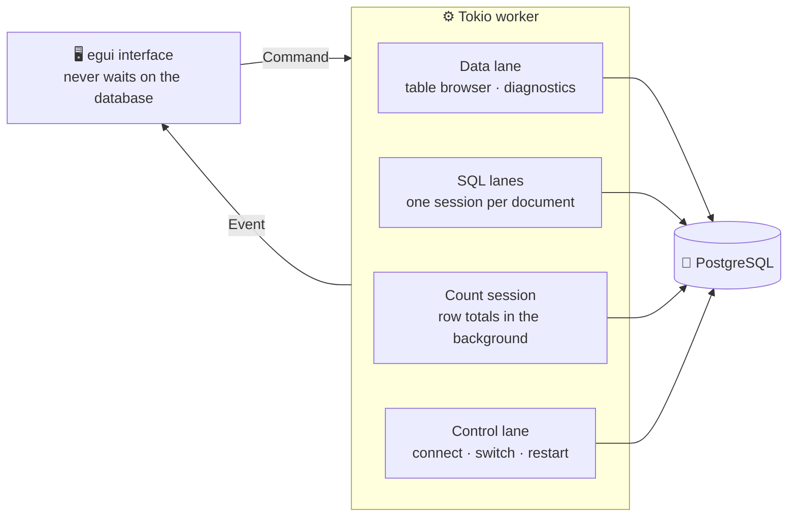

The window never waits for the database. All database work runs on a background
worker, and the table browser and each SQL document use separate sessions. More
in [docs/architecture.md](docs/architecture.md).

<br/>

## 🛠 Development

```sh
cargo fmt --check
cargo clippy --locked --all-targets --all-features -- -D warnings
cargo test --locked
sh scripts/test-postgres.sh
```

`scripts/test-postgres.sh` runs the database tests on temporary PostgreSQL
servers. It never connects to your own databases. Tests, screenshots, and
releases are described in [docs/development.md](docs/development.md).

<br/>

## 🧩 Limitations

- Tested with PostgreSQL 14, 16, 18, and 19. CockroachDB, Redshift, and other
  PostgreSQL-compatible databases are not tested.
- Postern does not have every Postico feature. What is missing is listed in
  [ROADMAP.md](ROADMAP.md).

<br/>

## 📄 License

Postern is released under the [MIT License](LICENSE). Copyright © 2026 Lucky-Dutch.

<div align="center">
<br/>
<sub>Built with 🦀 Rust, <a href="https://github.com/emilk/egui">egui</a>, <a href="https://tokio.rs">Tokio</a>, and <a href="https://github.com/sfackler/rust-postgres">tokio-postgres</a>.</sub>
</div>
